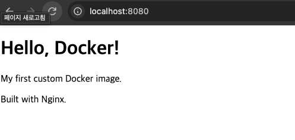
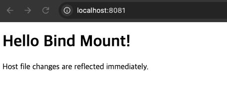

# 개발 워크스테이션 구축 실습

## 0. 프로젝트 구조

```text
dev-e1-1/
├── Dockerfile              # workstation-web:v1 이미지 빌드 정의
├── README.md               # 실습 기록 및 증빙 문서
├── .gitignore              # 커밋 제외 대상 (.DS_Store, *.log, .env 등)
├── app/
│   └── index.html          # Nginx가 서비스하는 정적 웹 페이지
├── docs/
│   └── images/             # 실습 증빙 스크린샷
│       ├── nginx-web.png
│       └── bind-mount.png
├── practice/
│   └── hello.txt           # 터미널 기본 명령어 실습 파일
├── permission-test.txt     # 파일 권한(chmod 644) 실습 파일
└── permission-dir/         # 디렉터리 권한(chmod 755) 실습 디렉터리
```

| 경로 | 역할 |
|---|---|
| `Dockerfile` | 베이스 이미지(`nginx:alpine`)와 웹 페이지 복사 단계를 정의 |
| `app/` | 웹 서버 콘텐츠. 이미지에 COPY 되거나 Bind Mount 대상이 됨 |
| `docs/images/` | README에 삽입하는 증빙 이미지 |
| `practice/` | 터미널 명령어(cp/mv/rm 등) 연습용 작업 공간 |
| `permission-*` | chmod 권한 실습 대상 |

모든 명령어는 프로젝트 루트(`dev-e1-1/`)에서 실행한다.

## 1. 터미널 기본 명령어 및 권한 관리

### 기본 명령어 실습

| 명령어 | 설명 |
|---|---|
| `pwd` | 현재 작업 디렉터리 확인 |
| `ls` | 파일 및 디렉터리 목록 확인 |
| `ls -la` | 숨김 파일을 포함한 상세 목록 확인 |
| `cd` | 디렉터리 이동 |
| `mkdir -p` | 디렉터리 생성 |
| `touch` | 파일 생성 |
| `echo` | 문자열 출력 및 파일 작성 |
| `cat` | 파일 내용 확인 |
| `cp` | 파일 복사 |
| `mv` | 파일 이동 및 이름 변경 |
| `rm` | 파일 삭제 |

### 실행 결과

```text
$ pwd
/Users/hyungchul/Desktop/codyssey/dev-e1-1
$ mkdir -p practice
$ touch practice/hello.txt
$ echo 'Hello Workstation' > practice/hello.txt
$ cat practice/hello.txt
Hello Workstation
$ cp practice/hello.txt practice/hello-copy.txt
$ mv practice/hello-copy.txt practice/hello-moved.txt
$ ls -la practice
total 16
drwxr-xr-x  4 hyungchul  wheel  128 Nov 17 14:01 .
drwxr-xr-x  3 hyungchul  wheel   96 Nov 17 14:01 ..
-rw-r--r--  1 hyungchul  wheel   18 Nov 17 14:01 hello-moved.txt
-rw-r--r--  1 hyungchul  wheel   18 Nov 17 14:01 hello.txt
$ rm practice/hello-moved.txt
$ ls practice
hello.txt
```

> `pwd` 결과는 실습 환경에 따라 경로가 달라질 수 있다.

### 파일 및 디렉터리 권한 변경

```bash
chmod 644 permission-test.txt
chmod 755 permission-dir
```

- `644`: 소유자는 읽기·쓰기, 나머지는 읽기 가능
- `755`: 소유자는 읽기·쓰기·실행, 나머지는 읽기·실행 가능

#### 권한 비트 표

권한은 `r=4`, `w=2`, `x=1`의 합으로 표현하며 소유자(u) / 그룹(g) / 기타(o) 순서로 한 자리씩 적는다.

| 숫자 | 이진 | rwx | 의미 |
|---|---|---|---|
| 0 | 000 | `---` | 권한 없음 |
| 1 | 001 | `--x` | 실행 |
| 2 | 010 | `-w-` | 쓰기 |
| 3 | 011 | `-wx` | 쓰기 + 실행 |
| 4 | 100 | `r--` | 읽기 |
| 5 | 101 | `r-x` | 읽기 + 실행 |
| 6 | 110 | `rw-` | 읽기 + 쓰기 |
| 7 | 111 | `rwx` | 읽기 + 쓰기 + 실행 |

예) `644` = 소유자 `6`(rw-), 그룹 `4`(r--), 기타 `4`(r--) → `-rw-r--r--`
예) `755` = 소유자 `7`(rwx), 그룹 `5`(r-x), 기타 `5`(r-x) → `drwxr-xr-x`

#### 실행 결과 (chmod 전/후 `ls -ld`)

```text
$ chmod 600 permission-test.txt; chmod 700 permission-dir
$ ls -ld permission-test.txt permission-dir        # 변경 전
drwx------  2 hyungchul  wheel  64 Nov 17 14:01 permission-dir
-rw-------  1 hyungchul  wheel   0 Nov 17 14:01 permission-test.txt
$ chmod 644 permission-test.txt
$ chmod 755 permission-dir
$ ls -ld permission-test.txt permission-dir        # 변경 후
drwxr-xr-x  2 hyungchul  wheel  64 Nov 17 14:01 permission-dir
-rw-r--r--  1 hyungchul  wheel   0 Nov 17 14:01 permission-test.txt
```

디렉터리는 `x` 권한이 있어야 내부로 `cd` 할 수 있으므로 `755`를 사용한다.

## 2. Docker 기본 실습

### Docker 상태 확인

```bash
docker --version
docker info
docker images
docker ps -a
```

실행 결과:

```text
$ docker --version
Docker version 29.9.2, build a82e528901
$ docker info | grep -E 'Server Version|Operating System|OSType|Architecture|CPUs|Total Memory|Containers:|Images:'
 Containers: 6
 Images: 4
 Server Version: 29.9.2
 Operating System: Docker Desktop
 OSType: linux
 Architecture: aarch64
 CPUs: 10
 Total Memory: 7.748GiB
```

`docker info`가 `Server Version` 등을 정상 출력하므로 Docker 데몬이 실행 중임을 확인했다.

### Hello World 실행

```bash
docker run hello-world
```

Docker 이미지 다운로드 및 컨테이너 실행을 확인했다.

실행 결과:

```text
$ docker run --rm hello-world

Hello from Docker!
This message shows that your installation appears to be working correctly.

To generate this message, Docker took the following steps:
 1. The Docker client contacted the Docker daemon.
 2. The Docker daemon pulled the "hello-world" image from the Docker Hub.
    (arm64v8)
 3. The Docker daemon created a new container from that image which runs the
    executable that produces the output you are currently reading.
 4. The Docker daemon streamed that output to the Docker client, which sent it
    to your terminal.
...
```

### 이미지·컨테이너 상태 확인 결과

```text
$ docker ps -a --format 'table {{.Names}}\t{{.Image}}\t{{.Status}}'
NAMES              IMAGE                STATUS
workstation-web    workstation-web:v1   Up 14 seconds
workstation-bind   nginx:alpine         Exited (0) 55 minutes ago
ubuntu-daemon      ubuntu:latest        Exited (137) 12 days ago
ubuntu-practice    ubuntu:latest        Exited (0) 12 days ago
bold_hawking       hello-world          Exited (0) 12 days ago
mybox              ubuntu               Exited (130) 2 weeks ago

$ docker images
IMAGE                ID             DISK USAGE   CONTENT SIZE   EXTRA
hello-world:latest   c567b231f656       22.6kB         10.3kB   U
nginx:alpine         785835ea65db       94.1MB         27.2MB   U
ubuntu:latest        6a06111c3b0a        181MB         44.9MB   U
workstation-web:v1   b26202e2b60f       93.2MB         26.3MB   U
```

### 이미지(Image)와 컨테이너(Container)의 차이

| 구분 | 이미지 | 컨테이너 |
|---|---|---|
| 정의 | 실행에 필요한 파일시스템·설정을 담은 읽기 전용 템플릿 | 이미지를 기반으로 만든 실행 가능한 인스턴스 |
| 생성 | `docker build`, `docker pull` | `docker run`, `docker create` |
| 상태 | 변하지 않음 (불변, 레이어 구조) | 생성됨 → 실행 중 → 중지됨 → 삭제됨으로 상태가 변함 |
| 변경 | 변경 시 새 이미지(새 태그)를 빌드해야 함 | 쓰기 가능한 레이어에 변경이 쌓이며 삭제하면 함께 사라짐 |
| 관계 | 하나의 이미지로 여러 컨테이너 생성 가능 | 항상 하나의 이미지에서 파생됨 |

- `docker build` → 이미지 생성
- `docker run` → 이미지로부터 컨테이너 생성 및 실행
- `docker stop` / `docker start` → 컨테이너 상태 변경 (이미지는 그대로)
- `docker rm` → 컨테이너 삭제 (이미지 유지), `docker rmi` → 이미지 삭제

예: `ubuntu:latest` 이미지 하나에서 `ubuntu-practice`, `ubuntu-daemon` 두 컨테이너를 만들었고, 컨테이너별 상태(`Exited (0)` / `Exited (137)`)가 서로 독립적이다.

### Ubuntu 컨테이너 실행

```bash
docker run -it --name ubuntu-practice ubuntu:latest bash
```

컨테이너 내부에서 운영체제 정보 확인:

```bash
cat /etc/os-release
```

### 백그라운드 컨테이너 실행

```bash
docker run -d --name ubuntu-daemon ubuntu:latest sleep infinity
```

컨테이너 내부 접속:

```bash
docker exec -it ubuntu-daemon bash
```

컨테이너 리소스 확인:

```bash
docker stats --no-stream ubuntu-daemon
```

컨테이너 중지:

```bash
docker stop ubuntu-daemon
```

## 3. Dockerfile을 이용한 웹 서버 구축

### Dockerfile 작성

```dockerfile
FROM nginx:alpine

COPY app/index.html /usr/share/nginx/html/index.html

EXPOSE 80
```

### 이미지 빌드

```bash
docker build -t workstation-web:v1 .
```

빌드 결과 (성공):

```text
$ docker build -t workstation-web:v1 .
#1 [internal] load build definition from Dockerfile
#1 transferring dockerfile: 120B done
#2 [internal] load metadata for docker.io/library/nginx:alpine
#4 [internal] load build context
#4 transferring context: 290B done
#5 [1/2] FROM docker.io/library/nginx:alpine@sha256:785835ea65db...
#6 [2/2] COPY app/index.html /usr/share/nginx/html/index.html
#6 DONE 0.0s
#7 exporting to image
#7 naming to docker.io/library/workstation-web:v1 done
#7 unpacking to docker.io/library/workstation-web:v1 done
#7 DONE 0.1s
```

### 컨테이너 실행 및 포트 매핑

```bash
docker run -d --name workstation-web -p 8080:80 workstation-web:v1
```

- 호스트 포트: `8080`
- 컨테이너 포트: `80`

웹 브라우저에서 접속:

```text
http://localhost:8080
```

응답 확인:

```bash
curl http://localhost:8080
```

실행 결과:

```text
$ docker ps
CONTAINER ID   IMAGE                COMMAND                  CREATED         STATUS         PORTS                                     NAMES
e3a509df291c   workstation-web:v1   "/docker-entrypoint.…"   2 seconds ago   Up 2 seconds   0.0.0.0:8080->80/tcp, [::]:8080->80/tcp   workstation-web

$ curl -s http://localhost:8080
<!DOCTYPE html>
<html lang="ko">
<head>
    <meta charset="UTF-8">
    <title>Bind Mount Test</title>
</head>
<body>
    <h1>Hello Bind Mount!</h1>
    <p>Host file changes are reflected immediately.</p>
</body>
</html>

$ curl -sI http://localhost:8080 | head -3
HTTP/1.1 200 OK
Server: nginx/1.31.8
Date: Tue, 17 Nov 2026 05:01:58 GMT
```

### 네트워크 네임스페이스와 포트 포워딩 원리

- 컨테이너는 리눅스 **네트워크 네임스페이스**로 호스트와 네트워크 스택(인터페이스, IP, 라우팅 테이블, 포트 공간)이 격리된다.
- 그래서 컨테이너 안의 Nginx가 `80`번 포트를 열어도 호스트의 `80`번 포트와는 무관하며, 호스트(브라우저·curl)에서 직접 접근할 수 없다.
- `-p 8080:80`은 **호스트 `8080`으로 들어온 트래픽을 컨테이너 `80`으로 전달(포트 포워딩, NAT)**하는 규칙을 만든다.
- 이 방식 덕분에 컨테이너 내부 포트는 고정해 두고, 호스트 포트만 바꿔서 같은 이미지를 여러 개 동시에 띄울 수 있다. (예: `8080:80`, `8081:80`)
- `docker ps`의 `0.0.0.0:8080->80/tcp`가 이 매핑을 나타내며, `EXPOSE 80`은 문서화 목적일 뿐 실제 포트 공개는 `-p`가 담당한다.

### 포트 충돌 진단 및 해결 절차

같은 호스트 포트를 두 컨테이너가 쓰려 하면 다음 오류가 발생한다.

```text
$ docker run -d --name port-conflict -p 8080:80 nginx:alpine
docker: Error response from daemon: ... Bind for 0.0.0.0:8080 failed: port is already allocated
```

1. **포트를 사용 중인 프로세스 확인**

   ```bash
   lsof -nP -iTCP:8080 -sTCP:LISTEN     # macOS / Linux
   ss -ltnp | grep 8080                 # Linux
   netstat -an | grep 8080              # 공통
   ```

   ```text
   $ lsof -nP -iTCP:8080 -sTCP:LISTEN
   COMMAND    PID      USER   FD   TYPE            DEVICE SIZE/OFF NODE NAME
   com.docke 5900 hyungchul   74u  IPv6 0x64cc7533d9491c9      0t0  TCP *:8080 (LISTEN)
   ```

   Docker Desktop이 포트를 점유하고 있다면 컨테이너가 사용 중이라는 뜻이다.

2. **어느 컨테이너가 점유 중인지 확인**

   ```bash
   docker ps --filter publish=8080
   ```

3. **해결 (택 1)**
   - 점유 컨테이너 중지/삭제: `docker stop workstation-web` 또는 `docker rm -f workstation-web`
   - 일반 프로세스라면 PID 확인 후 종료: `kill <PID>` (응답 없을 때만 `kill -9 <PID>`)
   - 호스트 포트 변경: `docker run -d -p 8082:80 ...`

4. **재확인**: `docker ps`로 포트 매핑이 정상인지, `curl http://localhost:<포트>`로 응답이 오는지 확인한다.

### 실행 결과



## 4. Bind Mount 실습

호스트의 파일과 컨테이너 내부의 디렉터리를 연결한다.

### Bind Mount 컨테이너 실행

```bash
docker run -d \
  --name workstation-bind \
  -p 8081:80 \
  -v "$(pwd)/app:/usr/share/nginx/html:ro" \
  nginx:alpine
```

#### 절대경로(`$(pwd)`)를 사용한 이유

- Docker의 `-v` 옵션에서 `./app` 같은 상대경로는 Named Volume 이름으로 해석될 수 있어, 호스트 경로를 명확히 지정하려면 절대경로가 필요하다.
- `$(pwd)`는 명령 실행 시점의 현재 디렉터리 절대경로로 치환되므로, `/Users/hyungchul/...` 같은 **사용자 고유 경로를 하드코딩하지 않아도** 되어 다른 PC·다른 위치에 clone 해도 동일한 명령으로 재현된다.
- 단, 반드시 프로젝트 루트에서 실행해야 하며(경로 기준이 `pwd`), 공백이 있는 경로를 대비해 `"..."`로 감싼다.
- `:ro`(읽기 전용)를 붙여 컨테이너가 호스트 파일을 변경하지 못하도록 했다.

호스트의 `app/index.html` 파일을 수정한 뒤 다음 명령어로 확인한다.

```bash
curl http://localhost:8081
```

호스트 파일 변경 사항이 컨테이너에 즉시 반영되는 것을 확인했다.

### 실행 결과



## 5. Docker Volume 실습

### Volume 생성

```bash
docker volume create workstation-data
```

### 컨테이너에서 데이터 저장

```bash
docker run --name volume-writer \
  -v workstation-data:/data \
  ubuntu:latest \
  bash -c 'echo "Docker Volume Persistence Test" > /data/message.txt && cat /data/message.txt'
```

### 컨테이너 삭제

```bash
docker rm volume-writer
```

### 데이터 유지 확인

```bash
docker run --rm \
  -v workstation-data:/data \
  ubuntu:latest \
  cat /data/message.txt
```

컨테이너를 삭제한 후에도 Volume에 저장된 데이터가 유지되는 것을 확인했다.

실행 결과:

```text
$ docker volume create workstation-data
workstation-data
$ docker run --name volume-writer -v workstation-data:/data ubuntu:latest bash -c 'echo "Docker Volume Persistence Test" > /data/message.txt && cat /data/message.txt'
Docker Volume Persistence Test
$ docker rm volume-writer
volume-writer
$ docker ps -a --filter name=volume-writer          # 컨테이너가 삭제되어 목록이 비어 있음
CONTAINER ID   IMAGE     COMMAND   CREATED   STATUS    PORTS     NAMES
$ docker run --rm -v workstation-data:/data ubuntu:latest cat /data/message.txt
Docker Volume Persistence Test
```

컨테이너(`volume-writer`)가 삭제된 뒤에도 `/data/message.txt` 내용이 그대로 출력되어 데이터 지속성이 증명된다.

### Volume 백업 및 복구

**백업**: 임시 컨테이너로 Volume을 읽기 전용 마운트하고, 호스트의 `backup/` 디렉터리에 tar로 압축한다.

```bash
mkdir -p backup
docker run --rm \
  -v workstation-data:/data:ro \
  -v "$(pwd)/backup:/backup" \
  ubuntu:latest \
  tar czf /backup/workstation-data.tar.gz -C /data .
```

**복구**: Volume을 (재)생성한 뒤 tar를 풀어 넣는다.

```bash
docker volume rm workstation-data          # 유실 상황 가정
docker volume create workstation-data
docker run --rm \
  -v workstation-data:/data \
  -v "$(pwd)/backup:/backup" \
  ubuntu:latest \
  tar xzf /backup/workstation-data.tar.gz -C /data
```

실행 결과:

```text
$ ls -l backup
-rw-r--r--  1 hyungchul  staff  184 Nov 17 14:02 workstation-data.tar.gz
$ docker volume rm workstation-data
workstation-data
$ docker volume create workstation-data
workstation-data
$ docker run --rm -v workstation-data:/data ubuntu:latest ls -A /data      # 새 Volume은 비어 있음
$ docker run --rm -v workstation-data:/data -v "$(pwd)/backup:/backup" ubuntu:latest tar xzf /backup/workstation-data.tar.gz -C /data
$ docker run --rm -v workstation-data:/data ubuntu:latest cat /data/message.txt
Docker Volume Persistence Test
```

Volume을 삭제했다가 백업본으로 복구한 뒤 동일한 데이터가 확인되었다. (`backup/` 은 실습 후 삭제했다.)

## 6. Git 및 GitHub 연동

### Git 버전 확인

```bash
git --version
```

### Git 사용자 설정

```bash
git config --global user.name "charles"
git config --global user.email "kch1759@naver.com"
```

프로젝트별 사용자 설정:

```bash
git config user.name "Char1-es"
git config user.email "kch1759@gmail.com"
```

### Git 저장소 상태 확인

```bash
git status
```

### 변경 사항 커밋

```bash
git add .
git commit -m "chore: setting docker workstation"
```

### GitHub SSH 연결 확인

```bash
ssh -T git@github-new
```

### 원격 저장소 확인

```bash
git remote -v
```

### GitHub에 Push

```bash
git push -u origin main
```

GitHub 저장소: https://github.com/Char1-es/dev-e1-1

### 실행 결과 (원격 저장소 / 커밋 / Push 증거)

```text
$ git remote -v
origin	git@github-new:Char1-es/dev-e1-1.git (fetch)
origin	git@github-new:Char1-es/dev-e1-1.git (push)

$ ssh -T git@github-new
Hi Char1-es! You've successfully authenticated, but GitHub does not provide shell access.

$ git log --format='%h %an %ad %s' --date=short
a427e2c Char1-es 2026-11-04 docs: add README file
4583e30 Char1-es 2026-11-04 docs: add README and evidence images
5851785 Char1-es 2026-11-04 chore: setting docker workstation

$ git ls-remote origin          # GitHub 원격 main이 로컬 최신 커밋과 동일
a427e2c63fc52c12e7d55e1a4bc875a4dabe55c3	HEAD
a427e2c63fc52c12e7d55e1a4bc875a4dabe55c3	refs/heads/main
```

원격 `refs/heads/main`의 커밋 해시(`a427e2c`)가 로컬 최신 커밋과 일치하므로 Push가 완료되었음을 확인할 수 있다.
커밋 히스토리: https://github.com/Char1-es/dev-e1-1/commits/main

## 7. VS Code 연동

프로젝트 디렉터리에서 다음 명령어를 실행한다.

```bash
code .
```

VS Code의 Source Control 메뉴에서 Git 변경 사항을 확인하고, 터미널에서 다음 명령어로 브랜치 상태를 확인했다.

```bash
git status -sb
```

## 8. 트러블슈팅

### 문제 1. 종료된 컨테이너에 docker exec 실행

**발생 상황**

```text
Error response from daemon:
container ... is not running
```

**원인**

`bash -c` 명령어 실행이 완료되면서 컨테이너의 메인 프로세스가 종료됐다.

**해결 방법**

문제 발생 시 터미널 출력 (예시):

```text
$ docker exec -it volume-writer cat /data/message.txt
Error response from daemon: container <ID> is not running
$ docker ps -a --filter name=volume-writer
CONTAINER ID   IMAGE          COMMAND                  STATUS
<ID>           ubuntu:latest  "bash -c 'echo ...'"     Exited (0) ...
```

`docker ps -a`의 `Exited (0)`으로 명령 실행 직후 컨테이너가 종료된 것을 확인(가설 → 확인)한 뒤, 기존 컨테이너 대신 새로운 임시 컨테이너를 실행해 Volume 데이터를 확인했다(조치).

```bash
docker run --rm -v workstation-data:/data ubuntu:latest cat /data/message.txt
```

### 문제 2. GitHub Push 시 SSH 인증 실패

**발생 상황**

일반적인 `git push` 실행 시 SSH 인증에 실패했다.

**원인**

Git이 의도한 SSH 개인키를 사용하지 못하는 문제가 발생했다.

**발생 시 출력 (예시)**

```text
$ git push
git@github.com: Permission denied (publickey).
fatal: Could not read from remote repository.
```

**해결 방법**

SSH Agent에 키를 등록했다.

```bash
ssh-add --apple-use-keychain ~/.ssh/id_ed25519_new
```

프로젝트에 사용할 SSH 명령어를 지정했다.

```bash
git config core.sshCommand "ssh -i /Users/hyungchul/.ssh/id_ed25519_new -o IdentitiesOnly=yes"
```

이후 일반적인 `git push` 명령어로 정상적으로 업로드되는 것을 확인했다.
(`ssh -T git@github-new` → `Hi Char1-es! You've successfully authenticated...`)

## 9. 실습 증빙 자료

실습 과정에서 확인한 스크린샷은 `docs/images/` 디렉터리에 저장했다.

| 파일명 | 증빙 내용 |
|---|---|
| `nginx-web.png` | Dockerfile 기반 Nginx 웹 서버 실행 결과 |
| `bind-mount.png` | Bind Mount를 통한 호스트 파일 변경 반영 결과 |