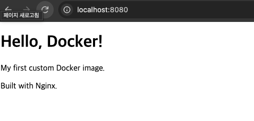
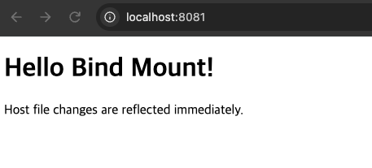

# 개발 워크스테이션 구축 실습

## 1. 터미널 기본 명령어 및 권한 관리

### 기본 명령어 실습

| 명령어 | 설명 |
|---|---|
| `pwd` | 현재 작업 디렉터리 확인 |
| `ls` | 파일 및 디렉터리 목록 확인 |
| `ls -la` | 숨김 파일을 포함한 상세 목록 확인 |
| `cd` | 디렉터리 이동 |
| `mkdir -p` | 디렉터리 생성 |
| `touch` | 파일 생성 |
| `echo` | 문자열 출력 및 파일 작성 |
| `cat` | 파일 내용 확인 |
| `cp` | 파일 복사 |
| `mv` | 파일 이동 및 이름 변경 |
| `rm` | 파일 삭제 |

### 파일 및 디렉터리 권한 변경

```bash
chmod 644 permission-test.txt
chmod 755 permission-dir
```

- `644`: 소유자는 읽기·쓰기, 나머지는 읽기 가능
- `755`: 소유자는 읽기·쓰기·실행, 나머지는 읽기·실행 가능

## 2. Docker 기본 실습

### Docker 상태 확인

```bash
docker --version
docker info
docker images
docker ps -a
```

### Hello World 실행

```bash
docker run hello-world
```

Docker 이미지 다운로드 및 컨테이너 실행을 확인했다.

### Ubuntu 컨테이너 실행

```bash
docker run -it --name ubuntu-practice ubuntu:latest bash
```

컨테이너 내부에서 운영체제 정보 확인:

```bash
cat /etc/os-release
```

### 백그라운드 컨테이너 실행

```bash
docker run -d --name ubuntu-daemon ubuntu:latest sleep infinity
```

컨테이너 내부 접속:

```bash
docker exec -it ubuntu-daemon bash
```

컨테이너 리소스 확인:

```bash
docker stats --no-stream ubuntu-daemon
```

컨테이너 중지:

```bash
docker stop ubuntu-daemon
```

## 3. Dockerfile을 이용한 웹 서버 구축

### Dockerfile 작성

```dockerfile
FROM nginx:alpine

COPY app/index.html /usr/share/nginx/html/index.html

EXPOSE 80
```

### 이미지 빌드

```bash
docker build -t workstation-web:v1 .
```

### 컨테이너 실행 및 포트 매핑

```bash
docker run -d --name workstation-web -p 8080:80 workstation-web:v1
```

- 호스트 포트: `8080`
- 컨테이너 포트: `80`

웹 브라우저에서 접속:

```text
http://localhost:8080
```

응답 확인:

```bash
curl http://localhost:8080
```

### 실행 결과



## 4. Bind Mount 실습

호스트의 파일과 컨테이너 내부의 디렉터리를 연결한다.

### Bind Mount 컨테이너 실행

```bash
docker run -d \
  --name workstation-bind \
  -p 8081:80 \
  -v "$(pwd)/app:/usr/share/nginx/html:ro" \
  nginx:alpine
```

호스트의 `app/index.html` 파일을 수정한 뒤 다음 명령어로 확인한다.

```bash
curl http://localhost:8081
```

호스트 파일 변경 사항이 컨테이너에 즉시 반영되는 것을 확인했다.

### 실행 결과



## 5. Docker Volume 실습

### Volume 생성

```bash
docker volume create workstation-data
```

### 컨테이너에서 데이터 저장

```bash
docker run --name volume-writer \
  -v workstation-data:/data \
  ubuntu:latest \
  bash -c 'echo "Docker Volume Persistence Test" > /data/message.txt && cat /data/message.txt'
```

### 컨테이너 삭제

```bash
docker rm volume-writer
```

### 데이터 유지 확인

```bash
docker run --rm \
  -v workstation-data:/data \
  ubuntu:latest \
  cat /data/message.txt
```

컨테이너를 삭제한 후에도 Volume에 저장된 데이터가 유지되는 것을 확인했다.

## 6. Git 및 GitHub 연동

### Git 버전 확인

```bash
git --version
```

### Git 사용자 설정

```bash
git config --global user.name "charles"
git config --global user.email "kch1759@naver.com"
```

프로젝트별 사용자 설정:

```bash
git config user.name "Char1-es"
git config user.email "kch1759@gmail.com"
```

### Git 저장소 상태 확인

```bash
git status
```

### 변경 사항 커밋

```bash
git add .
git commit -m "chore: setting docker workstation"
```

### GitHub SSH 연결 확인

```bash
ssh -T git@github-new
```

### 원격 저장소 확인

```bash
git remote -v
```

### GitHub에 Push

```bash
git push -u origin main
```

GitHub 저장소: https://github.com/Char1-es/dev-e1-1

## 7. VS Code 연동

프로젝트 디렉터리에서 다음 명령어를 실행한다.

```bash
code .
```

VS Code의 Source Control 메뉴에서 Git 변경 사항을 확인하고, 터미널에서 다음 명령어로 브랜치 상태를 확인했다.

```bash
git status -sb
```

## 8. 트러블슈팅

### 문제 1. 종료된 컨테이너에 docker exec 실행

**발생 상황**

```text
Error response from daemon:
container ... is not running
```

**원인**

`bash -c` 명령어 실행이 완료되면서 컨테이너의 메인 프로세스가 종료됐다.

**해결 방법**

기존 컨테이너 대신 새로운 임시 컨테이너를 실행해 Volume 데이터를 확인했다.

```bash
docker run --rm -v workstation-data:/data ubuntu:latest cat /data/message.txt
```

### 문제 2. GitHub Push 시 SSH 인증 실패

**발생 상황**

일반적인 `git push` 실행 시 SSH 인증에 실패했다.

**원인**

Git이 의도한 SSH 개인키를 사용하지 못하는 문제가 발생했다.

**해결 방법**

SSH Agent에 키를 등록했다.

```bash
ssh-add --apple-use-keychain ~/.ssh/id_ed25519_new
```

프로젝트에 사용할 SSH 명령어를 지정했다.

```bash
git config core.sshCommand "ssh -i /Users/hyungchul/.ssh/id_ed25519_new -o IdentitiesOnly=yes"
```

이후 일반적인 `git push` 명령어로 정상적으로 업로드되는 것을 확인했다.

## 9. 실습 증빙 자료

실습 과정에서 확인한 스크린샷은 `docs/images/` 디렉터리에 저장했다.

| 파일명 | 증빙 내용 |
|---|---|
| `nginx-web.png` | Dockerfile 기반 Nginx 웹 서버 실행 결과 |
| `bind-mount.png` | Bind Mount를 통한 호스트 파일 변경 반영 결과 |